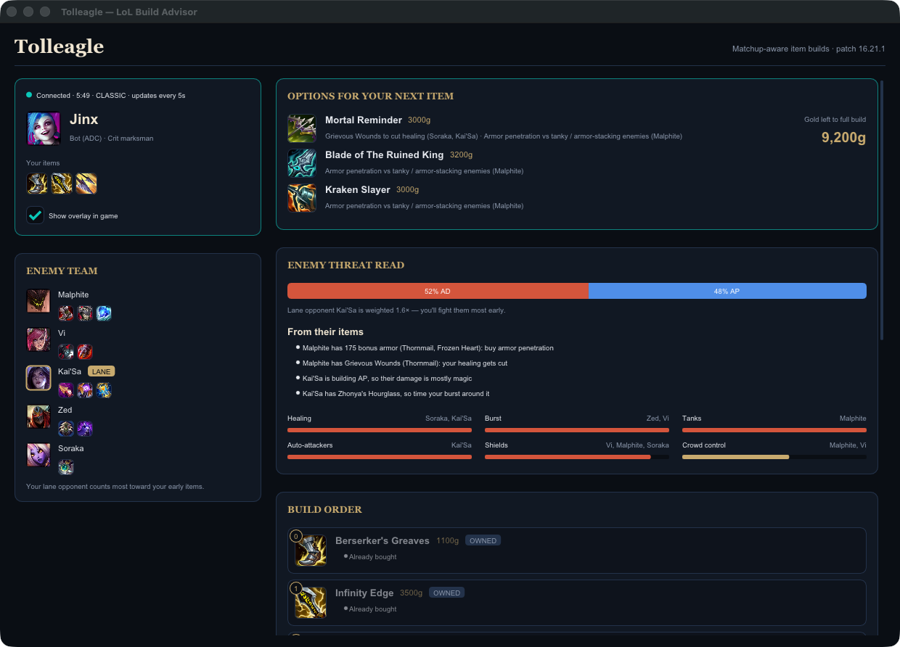
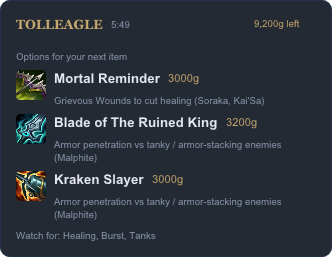
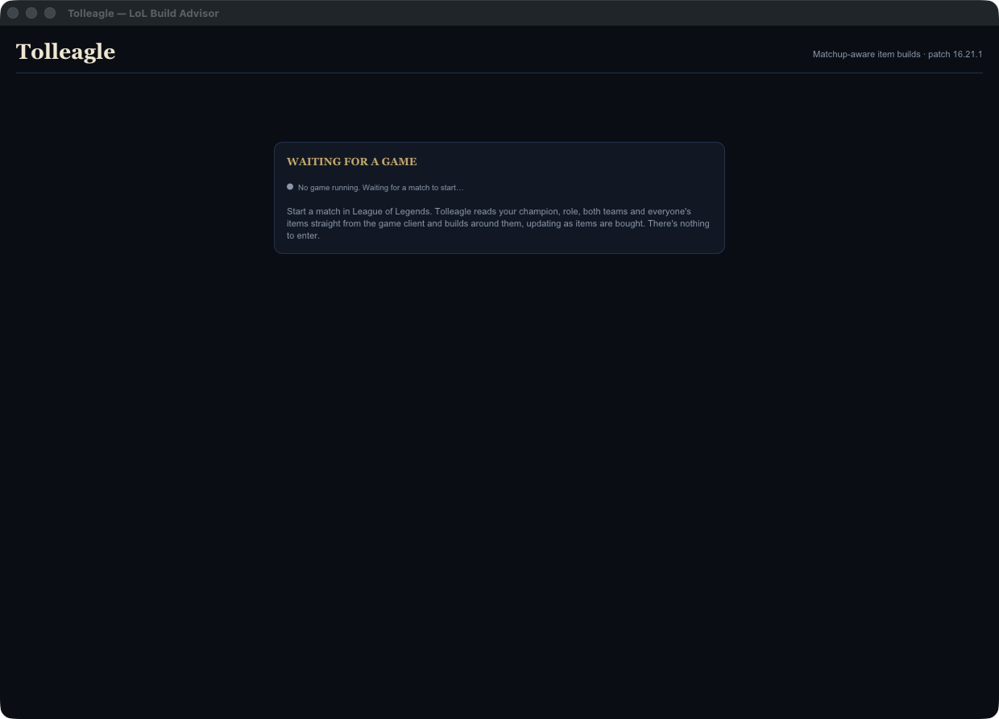

# Tolleagle

A matchup-aware League of Legends item build advisor. It's a native C++ desktop app. Start it, start a match, and it reads everything from the game: your champion, role and items, plus the enemy team and what they've bought. It then shows your best options for the next item, both in its window and in a small overlay on top of the game. There's nothing to enter.



<p>
  
  
</p>

*In-game screenshots use the bundled mock game (`tolleagle-mock-live`).*

```
 LEAGUE GAME CLIENT (while a match runs)       RIOT DATA (no API key)
 ┌──────────────────────────────────┐      ┌───────────────────────────────┐
 │ Live Client Data API :2999       │      │ Data Dragon CDN               │
 │  you · role · both teams · items │      │  champions · items · icons    │
 └───────────────┬──────────────────┘      └───────────────┬───────────────┘
                 │ polled every 5s (live/live_client)      │ at startup (data/ddragon)
                 ▼                                         ▼
                             ┌─────────────────────────────────────────────┐
                             │ 1. ANALYZE ENEMIES          engine/analyze  │
                             │   each enemy → damage type + threat traits  │
                             │   (healing, burst, CC, tanks, crit, poke…)  │
                             │   + their items (armor stacking, AP Kai'Sa, │
                             │   lifesteal, shields…)  engine/enemy_items  │
                             │   lane opponent counts 1.6×                 │
                             │   ⇒ NEEDS e.g. armor 0.8, anti-heal 0.9     │
                             └──────────────────────┬──────────────────────┘
                                                    ▼
                             ┌─────────────────────────────────────────────┐
                             │ 2. SCORE ITEMS            engine/recommend  │
                             │   score = fit for your build style          │
                             │         + how well it answers each NEED     │
                             │   early slots → your core damage items      │
                             │   later slots → counter the enemy team      │
                             │   one per unique passive (Lifeline, Hydra…) │
                             │   items you own are locked in first         │
                             └──────────────────────┬──────────────────────┘
                                                    ▼
                             ┌─────────────────────────────────────────────┐
                             │ 3. YOUR BUILD          ui/app · ui/overlay  │
                             │   next-item options · Boots · Items 1-5     │
                             │   marked Owned / Next slot, each with "why" │
                             │   + situational swaps · matchup tips        │
                             └─────────────────────────────────────────────┘
```

## Build

You need CMake 3.24+, a C++20 compiler and libcurl. GLFW, Dear ImGui and nlohmann/json are downloaded at configure time.

```bash
cmake -S . -B build
```

```bash
cmake --build build -j
```

- **macOS:** `brew install cmake`; libcurl and OpenGL ship with the system. The build produces `build/Tolleagle.app`, which you can drag into `/Applications`.
- **Windows:** get curl from vcpkg (`vcpkg install curl`) and pass `-DCMAKE_TOOLCHAIN_FILE=…/vcpkg.cmake`.
- **Linux:** install the libcurl and OpenGL/X11 dev packages.

## Run

```bash
open build/Tolleagle.app
```

Leave it running. It shows "Waiting for a game" until a match starts, then fills in by itself and updates every 5 seconds as items are bought.

### In-game overlay

While a match is running, a small card sits on the right edge of your screen. It shows the top three options for your next item, gold left to the full build, and the enemy team's biggest threats. Clicks pass straight through it to the game, and it hides when the game ends. You can turn it off with **Show overlay in game** in the main window.

The overlay is an ordinary always-on-top window. Nothing is injected into the game, so League has to run in **Borderless** or **Windowed** mode (Settings → Video → Window Mode) for the overlay to show above it.

### Without a real match

`tolleagle-mock-live` serves a fake game where players buy an item every ~20s:

```bash
./build/tolleagle-mock-live
```

```bash
LIVE_CLIENT_URL=http://127.0.0.1:2998 ./build/Tolleagle.app/Contents/MacOS/Tolleagle
```

### Engine check

`tolleagle-smoke` prints the recommended builds for a set of sample matchups using live Data Dragon data:

```bash
./build/tolleagle-smoke
```

## Layout

| Path | What |
| --- | --- |
| `src/data/` | Data Dragon loader, champion archetypes and threat traits, item knowledge |
| `src/engine/` | Enemy analysis and build scoring (no UI, no I/O) |
| `src/live/` | Live Client Data API parsing and background polling |
| `src/net/` | libcurl GET wrapper |
| `src/ui/` | Dear ImGui window and async icon cache |
| `tools/` | Smoke test and mock live-game server |
| `third_party/stb_image.h` | PNG decoding for icons (public domain) |

Data comes from Riot's Data Dragon and the League Live Client Data API. Tolleagle isn't endorsed by Riot Games. The recommendations are heuristics, so use your judgment.
